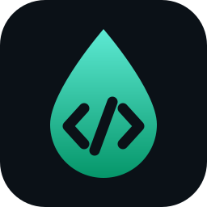

<p align="center">
  
</p>

# dropmind-web-guidance

[](https://github.com/LuisEBautistaR/dropmind-web-guidance/actions/workflows/fork-ci.yml)

Fork **sin telemetría y 100% offline** de [Modern Web Guidance](https://github.com/GoogleChrome/modern-web-guidance-src) de Google (Apache-2.0): guías curadas de la plataforma web moderna (HTML/CSS/JS, accesibilidad, performance, seguridad) para agentes de código, con CLI local de búsqueda, consulta y escaneo de patrones legacy.

> No es un producto de Google ni está respaldado por Google. Consulta [`NOTICE`](../NOTICE) y [`FORK.md`](../FORK.md).

## Diferencias con el oficial

| | Oficial (`modern-web-guidance`) | Este fork (`dropmind-web-guidance`) |
|---|---|---|
| Telemetría | Activada por defecto: manda tus queries, IDs de guías, SO y agente a `play.googleapis.com` | **Eliminada** (no hay watchdog ni Clearcut) |
| Ejecución | `npx -y modern-web-guidance@latest` en cada llamada (versión sin fijar, sale a internet) | Binario local `dropmind-web-guidance`, sin red |
| `install` / `update` / `uninstall` | Corren `npx skills` de Vercel (que tiene su propia telemetría a `skills.sh`) | Deshabilitados |
| Nombres | `modern-web-guidance`, `chrome-extensions` | `dropmind-web-guidance`, `dropmind-chrome-extensions` (pueden convivir con el oficial sin chocar) |
| CI | Workflows de Google (publish, triage, crons) | Un solo `fork-ci`: build, tests y verificación de cero red |

## Instalación

```bash
git clone https://github.com/LuisEBautistaR/dropmind-web-guidance && cd dropmind-web-guidance
pnpm install --frozen-lockfile --ignore-scripts
pnpm build:fork
SKILLS_DIR=~/.claude/skills ./scripts/install-local.sh
```

Requiere Node >= 22.18 y pnpm 10. Uso: `dropmind-web-guidance search "light dismiss dialog"`, `retrieve <id>`, `list`, `legacy-scan <ruta> --json`.

## Contribuir y seguridad

- [Cómo contribuir](CONTRIBUTING.md): el contenido de las guías va a upstream y lo del fork va aquí.
- [Política de seguridad](SECURITY.md)

El README original de upstream sigue en [`/README.md`](../README.md). El logo de este fork es propio y no tiene relación con el de Modern Web Guidance.
